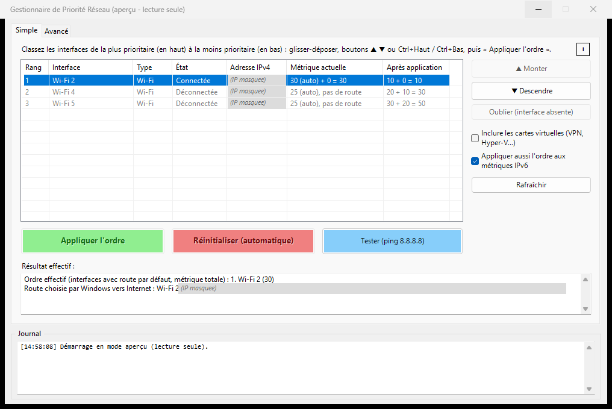
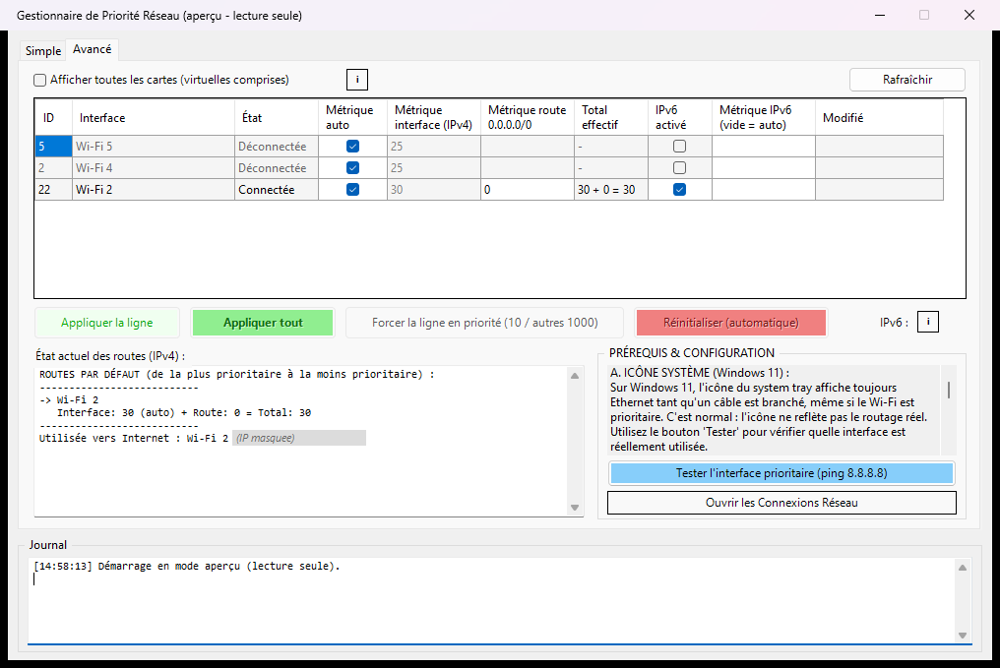

# Gestionnaire de Priorite Reseau (IPv4)

Utilitaire PowerShell pour choisir l'ordre dans lequel Windows utilise vos interfaces reseau (ex: **Wi-Fi** avant **Ethernet**, puis le dock USB...) en modifiant les metriques d'interface et de route.

L'application a deux vues (onglets) :
- **Simple** (par defaut) : vous classez les interfaces, l'application calcule et applique les metriques pour toutes.
- **Avance** : vous reglez chaque parametre, interface par interface.

| Vue Simple | Vue Avance |
|------------|------------|
|  |  |

---

## Prerequis

### 1. Droits Administrateur (Obligatoire)
Le script doit etre execute en tant qu'administrateur. Il demandera automatiquement l'elevation si necessaire.

### 2. Fichiers
Gardez ces fichiers dans le **meme dossier** :
- `CHOIX_RESEAU.ps1` : l'application (interface graphique)
- `NetIfaceSwitch.Core.ps1` : la logique (calcul des metriques, application, sauvegarde)
- `RESET_RESEAU.ps1` : remise a zero sans interface graphique

### 3. Creation du Raccourci
1. Clic-droit sur le bureau > **Nouveau** > **Raccourci**.
2. Entrez la cible suivante (adaptez le chemin si necessaire) :
    ```
    powershell.exe -WindowStyle Hidden -ExecutionPolicy Bypass -File "CHOIX_RESEAU.ps1"
    ```
    Ajoutez `-Vue Avance` a la fin pour ouvrir directement la vue Avance.
3. Nommez-le **"Gestionnaire Reseau"**.
4. Clic-droit sur le raccourci > **Proprietes** > **Avance** > cochez **Executer en tant qu'administrateur**.

---

## Vue Simple : classer les interfaces

1. Lancer l'application : la vue **Simple** liste les cartes physiques (nom, type Ethernet/Wi-Fi/Autre, etat, adresse IPv4, metrique actuelle, metrique apres application).
2. Classer les interfaces de la plus prioritaire (en haut) a la moins prioritaire (en bas) :
   - glisser-deposer une ligne sur une autre,
   - ou boutons **Monter** / **Descendre** (raccourcis Alt+M / Alt+D),
   - ou clavier : selectionner une ligne puis **Ctrl+Haut** / **Ctrl+Bas**.
3. Cliquer sur **Appliquer l'ordre** : la liste des modifications est affichee, rien n'est fait sans confirmation.
4. Apres application, le cadre **Resultat effectif** montre l'ordre reel de Windows et l'interface que Windows choisit pour joindre Internet (calcul local `Find-NetRoute`, sans envoyer de paquet). Le bouton **Tester (ping 8.8.8.8)** verifie avec un vrai ping.

### Schema de priorite automatique (N interfaces)

| Rang | Metrique d'interface | Metrique de route (0.0.0.0/0) | Metrique totale |
|------|----------------------|-------------------------------|-----------------|
| 1    | 10                   | 0                             | **10**          |
| 2    | 20                   | 10                            | **30**          |
| 3    | 30                   | 20                            | **50**          |
| N    | 10 x N               | 10 x (N - 1)                  | **20 x N - 10** |

- Windows utilise la route dont la **metrique totale** (interface + route) est la plus petite : les totaux sont strictement croissants et espaces de 20, donc la 1re interface connectee est toujours utilisee, puis la suivante si elle se deconnecte, etc.
- Une interface **deconnectee** recoit quand meme ses metriques : elle reprend sa place des qu'elle revient.
- Une interface **absente** (dock debranche...) garde son rang dans la liste (affichee grisee, "rang conserve") ; le bouton **Oublier** la retire de l'ordre.
- Option **Appliquer aussi l'ordre aux metriques IPv6** (cochee par defaut) : la metrique d'interface IPv6 recoit la meme valeur (10, 20, 30...), pour que le trafic IPv6 suive le meme ordre.
- Option **Inclure les cartes virtuelles** : ajoute VPN, Hyper-V/WSL... a la liste. Sinon ces cartes ne sont pas modifiees.
- Les interfaces non classees (virtuelles masquees) ne sont pas modifiees.

### Ordre sauvegarde
L'ordre applique est enregistre dans `%APPDATA%\network-iface-switch\order.json` et reaffiche au prochain lancement. Les interfaces sont reconnues par leur identifiant (GUID), meme si elles sont renommees.

### Reinitialiser (automatique)
Remet toutes les interfaces en metrique automatique (IPv4 et IPv6), les metriques de route par defaut a 0, et **oublie l'ordre sauvegarde**. Windows gere a nouveau les priorites. Le script `RESET_RESEAU.ps1` fait la meme chose en standalone.

---

## Vue Avance : tous les parametres

Le tableau affiche une ligne par interface (cocher **Afficher toutes les cartes** pour voir aussi les cartes virtuelles) :

| Colonne | Role |
|---------|------|
| Metrique auto | Cochee : Windows calcule la metrique selon le debit. Decochee : la valeur saisie est utilisee. |
| Metrique interface (IPv4) | 1 a 9999 (modifiable si "Metrique auto" est decochee). |
| Metrique route 0.0.0.0/0 | Metrique de la route par defaut de la carte (0 a 9999). Vide et grisee si la carte n'a pas de route par defaut (deconnectee). |
| Total effectif | Metrique d'interface + metrique de route : c'est cette valeur que Windows compare. |
| IPv6 active | Active/desactive IPv6 sur la carte. |
| Metrique IPv6 | Vide = automatique, sinon 1 a 9999. |

- Les lignes modifiees sont surlignees en jaune ; rien n'est applique avant d'avoir clique sur un bouton.
- **Appliquer la ligne** : applique uniquement la ligne selectionnee.
- **Appliquer tout** : applique toutes les lignes.
- **Forcer la ligne en priorite** : ancien mode "une seule interface prioritaire" (10 + 0 pour la ligne, 1000 + 1000 pour les autres cartes physiques).
- **Reinitialiser (automatique)** : comme dans la vue Simple.
- Le cadre **Etat actuel des routes** liste les routes par defaut de la plus prioritaire a la moins prioritaire (interface + route = total), et l'interface utilisee vers Internet.
- Les boutons **(i)** expliquent les metriques et l'IPv6.

### IPv6
Desactiver l'IPv6 peut aider a forcer la priorite car Windows utilise parfois l'IPv6 pour router le trafic, contournant les metriques IPv4. Le changement est fait au clic sur **Appliquer** (et non plus immediatement au clic sur la case).

---

## Securite des modifications

- **Validation complete avant d'appliquer** : toutes les valeurs de toutes les interfaces sont verifiees (nombres, limites, interface toujours presente...) ; s'il y a une erreur, rien n'est modifie.
- **Confirmation** : la liste exacte des modifications est affichee avant d'appliquer. Seules les valeurs qui changent sont modifiees.
- **Pas de configuration a moitie appliquee** : si une modification echoue, toutes celles deja faites sont annulees (retour aux valeurs d'origine) et un compte rendu par interface est affiche.
- **Journal** : chaque action (et son resultat) est affichee dans le cadre Journal en bas de la fenetre.

---

## Mode apercu
`CHOIX_RESEAU.ps1 -Apercu` ouvre l'application en lecture seule, sans demander l'elevation (boutons de modification desactives). Pratique pour consulter l'etat ou faire une capture d'ecran.

---

## Tests (developpeurs)
La logique (`NetIfaceSwitch.Core.ps1`) est testee avec Pester 5, les cmdlets reseau etant simulees (aucune modification du systeme) :
```
Install-Module Pester -MinimumVersion 5.5 -Scope CurrentUser
Invoke-Pester ./tests
```
Fonctionne sous Windows PowerShell 5.1 et PowerShell 7 (y compris Linux).

---

## Notes techniques
- **Metrique IP** : plus le chiffre est **bas**, plus la connexion est **prioritaire**.
- **Metrique totale** = metrique d'interface + metrique de route. Les deux sont modifiees par le script.
- **Compatibilite** : Windows 10/11, Windows PowerShell 5.1, sans dependance externe. Seul le bouton Tester envoie un ping (8.8.8.8).
- **Icone Windows 11** : l'icone du system tray ne reflete pas le routage reel. C'est un comportement normal.
- **Fins de ligne** : le fichier `.gitattributes` force les fins de ligne Windows (CRLF) pour les `.ps1` et `.md`.
